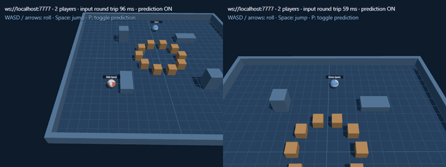

# Browser Game Multiplayer with three.js, Rapier (WASM) and Edgegap

A reference sample for **browser game multiplayer**: a three.js game with **Rapier WebAssembly physics** and an **authoritative Node.js game server**, playable from any browser over secure WebSockets (`wss://`). The client is static files on a CDN; only a slim server image is deployed on [Edgegap](https://edgegap.com), which starts game servers on demand close to the players.

**How do I make my browser or WebAssembly game multiplayer?** Run the game rules on an authoritative server that browsers reach over secure WebSockets (`wss://`), because browsers can't send raw UDP and a page served over `https://` may only open `wss://` connections. Host the client as static files on any CDN, and ship only the server in a slim container that Edgegap deploys on demand close to your players. In Edgegap, give the server's port the `WS` protocol with **TLS Upgrade** enabled, and connect to the deployment's host name and external port.

This repository is that sample. The same guide is on the Edgegap docs: [Make Your Browser (WebAssembly) Game Multiplayer](https://docs.edgegap.com/browser-webassembly-games/make-your-browser-game-multiplayer).

## What You'll Build

A three.js multiplayer arena where players roll balls and push crates around. Physics runs in [Rapier](https://rapier.rs), compiled to WebAssembly, in two places: on a Node.js game server that owns the authoritative simulation, and in the browser to predict the local player's movement so controls feel instant. The server runs at 30 ticks per second, takes only inputs from players, and sends every player a snapshot of all bodies each tick.



```
Browser (static files on a CDN or any static host)
  three.js rendering + Rapier WASM (client-side prediction)
        |
        |  wss://<deployment host>:<external port>
        v
Edgegap deployment (slim Node.js container, near the players)
  Node.js 22 LTS game server, ws library, fixed 30 Hz tick
  Rapier WASM in Node.js = authoritative physics
```

The same structure works for Babylon.js, PlayCanvas, Phaser or your own engine: only the client's rendering code changes.

## Why Browser Games Are Different

**Browsers can't use UDP.** Most game netcode sends UDP packets. Web pages can't open UDP sockets; real-time browser games use WebSockets (TCP) or WebTransport. This sample uses WebSockets, which every browser supports.

**Pages served over `https://` can only open `wss://` connections.** Your game page is almost always served over HTTPS (itch.io, GitHub Pages, any CDN). Chrome refuses `ws://` from such pages, so the game server must speak TLS, with a certificate that matches the address the client connects to. Edgegap does this for you with **TLS Upgrade**: it terminates TLS in front of your container with a valid certificate for the deployment's host name, so your Node.js server stays plain HTTP and WebSocket.

**Ship the client and the server separately.** A browser game is easy to bundle into one container that serves the page and runs the server. Don't: the client bundle (three.js, textures, audio, the WASM physics build) makes the image larger, so every deployment pulls more data and starts slower, and the extra files trip container scanners. Put the client on static hosting or a CDN, built once and cached worldwide. Put only the server in the image. In this sample the server image adds about 8 MB to the Node.js base image.

**Load WebAssembly without runtime downloads.** Rapier's `@dimforge/rapier3d-compat` package embeds its WASM binary in the JavaScript file. `await RAPIER.init()` compiles it from memory: no `.wasm` path to resolve inside the container, nothing fetched at startup, and the same code works in Node.js and the browser. The sample's server starts with networking disabled (`docker run --network none`), which proves it.

## 1. Run It Locally

You need [Node.js 22 or newer](https://nodejs.org/en/download) and, for the next step, [Docker](https://www.docker.com/products/docker-desktop/).

```bash
git clone https://github.com/edgegap/netcode-sample-threejs-rapier.git
cd netcode-sample-threejs-rapier
npm install
npm run dev
```

`npm run dev` compiles the server, starts it on port `7777` and starts the client on port `5173`. Open [http://localhost:5173/?server=localhost:7777](http://localhost:5173/?server=localhost:7777) in two browser windows. Roll with WASD or the arrow keys, jump with Space. Press P to switch prediction off and see the raw server delay on your own ball.

What's in the repository:

| Folder | What it does |
| --- | --- |
| `shared/` | Tick rate, arena, physics tuning, message types, and the Rapier setup used by both sides (`physics.ts`) |
| `server/` | Node.js game server: Rapier world, fixed 30 Hz loop, WebSocket server, `/health`, graceful shutdown, `Dockerfile` |
| `client/` | Vite + three.js client: rendering, input, prediction (`prediction.ts`), connection and error messages (`net.ts`) |

## 2. Containerize the Server

The server image is built from `server/Dockerfile`, from the repository root, so it can use the shared package:

```bash
docker build --platform linux/amd64 --provenance=false --sbom=false -f server/Dockerfile -t rapier-arena-server:20261118-1644 .
docker run -p 7777:7777 rapier-arena-server:20261118-1644
```

* `--platform linux/amd64`: Edgegap runs Linux x86-64 containers, also when you build on an ARM Mac.
* `--provenance=false --sbom=false`: Docker Desktop otherwise wraps the image in a multi-manifest index with attestations.
* Tag with a unique build ID, here a UTC timestamp, and never `latest`, so every deployment is reproducible.

What the Dockerfile does, and what it leaves out:

* **Multi-stage build.** The build stage installs all dependencies and compiles TypeScript. The runtime stage installs production dependencies only (`ws` and Rapier) and copies the compiled JavaScript.
* **No client files.** A `.dockerignore` allowlist sends Docker only the server, the shared package and the manifests: no client sources, no client build, no `node_modules`, no `.git`.
* **No unused Rapier files.** The server loads Rapier's ES module build, which embeds the WASM. The Dockerfile deletes the package's CommonJS copy, source maps and loose `.wasm` file (about 10 MB).
* **Pinned versions.** The base image is pinned by tag and digest (`node:22.23.4-alpine3.23@sha256:…`), and every npm dependency by exact version in `package.json` and `package-lock.json`.
* **Non-root user and PID 1.** The container runs as the `node` user, and `CMD ["node", "server/dist/index.js"]` runs Node.js directly, so the `SIGTERM` Edgegap sends on stop reaches the server instead of a shell or `npm`.

The result is 63.5 MB compressed (249 MB unpacked), of which about 8 MB is the game server and its dependencies on top of the official Node.js 22 Alpine image.

The server reads its port from `PORT` (default `7777`), answers `GET /health` with a small JSON status, closes every connection and exits on `SIGTERM`, and stops its own deployment after `EMPTY_SHUTDOWN_MINUTES` (default `5`) without players, including when nobody ever joins. That's what keeps a free-tier account from running an empty server until its maximum duration.

## 3. Deploy on Edgegap

Before you start, [create a free Edgegap account](https://app.edgegap.com/auth/register). Edgegap orchestrates your game servers: each deployment starts on demand at the location closest to its players, and stops when the server says it's done.

**Push the image.** Open [Container Registry](https://app.edgegap.com/registry-management/repositories/list) in the dashboard and note your project name, username and token. Then:

```bash
echo "<REGISTRY_TOKEN>" | docker login registry.edgegap.com -u "<REGISTRY_USERNAME>" --password-stdin
docker tag rapier-arena-server:20261118-1644 registry.edgegap.com/<PROJECT>/rapier-arena-server:20261118-1644
docker push registry.edgegap.com/<PROJECT>/rapier-arena-server:20261118-1644
```

The repository's `server-image.yml` workflow does the same on every push to `main` once you add the registry username and token as GitHub secrets.

**Create the application and version.** In [Applications](https://app.edgegap.com/application-management/applications/list), create an application, then a version that points to `registry.edgegap.com/<PROJECT>/rapier-arena-server` and your tag, with:

* **Resources** of 0.25 vCPU and 512 MB memory,
* **Port** `7777`, **Protocol** `WS`, **TLS Upgrade** enabled, **Name** `gameport`,
* **Max duration** of 30 to 60 minutes, as a safety net for test deployments,
* optionally `EMPTY_SHUTDOWN_MINUTES` as an environment variable.

**TLS Upgrade is what makes `wss://` work.** With it, Edgegap terminates TLS on the port with a certificate for the deployment's host name and forwards plain WebSocket traffic to port `7777` in your container. Without it, browsers on HTTPS pages can't connect.

**Deploy.** Choose the version and **Deploy**. Edgegap places the server near the player IP addresses it's given (yours, from the dashboard). When the deployment is **Ready**, its page shows:

* **Host**: the deployment's host name, e.g. `a1b2c3d4e5f6.pr.edgegap.net`,
* **External port** of `gameport`: a port Edgegap picks at random for each deployment, e.g. `31504`.

**Connect.** Open the client (locally, or the hosted page from the next step), enter `<host>:<external port>` and press **Connect**, or open the page with `?server=<host>:<external port>`. The client builds `wss://a1b2c3d4e5f6.pr.edgegap.net:31504` from it. Send the same link to a friend on another network: both of you land on the same authoritative server.

Your own tools get the same details from the API: [`GET /v1/status/{request_id}`](https://docs.edgegap.com/docs/api) returns `fqdn` and `ports.gameport.external`, and `ports.gameport.link` holds both. A matchmaker returns them in its assignment.

**Using a coding agent?** The [Edgegap MCP server](https://docs.edgegap.com/docs/mcp-integration) validates the Dockerfile and ports (`edgegap_validate_server_config`), creates the application and version (`edgegap_create_app`, `edgegap_create_app_version` with `protocol: "WS"` and `tls_upgrade: true`), deploys (`edgegap_deploy`) and returns the `wss://` address (`edgegap_wait_for_deployment`).

## 4. Host the Client

The client is plain static files. Build it once:

```bash
npm run build -w client
```

and upload `client/dist/` to any static host or CDN: GitHub Pages, Cloudflare Pages, Netlify, an S3 bucket behind CloudFront, or your own web server. Vite's `base: "./"` makes every path relative, so the build works from any folder.

The sample's `pages.yml` workflow publishes `client/dist/` to GitHub Pages on every push. Try it: [edgegap.github.io/netcode-sample-threejs-rapier](https://edgegap.github.io/netcode-sample-threejs-rapier/).

The client's own WASM (Rapier, for prediction) is embedded in the JavaScript bundle too, so there's no `.wasm` file to serve with the right MIME type. The bundle is about 4.9 MB (1.8 MB gzipped); most of it is Rapier. A CDN caches it after the first load.

## 5. Troubleshooting

Browsers give scripts no details about a failed WebSocket: the `close` event only says code `1006`. The **browser console** (F12) has the real cause. The sample's client shows the matching fix under the **Connect** button. The messages below are copied from Chrome 157 and Edge 157 (Windows), with your address in place of the example's.

<details>

<summary>Mixed content: <code>ws://</code> from an <code>https://</code> page</summary>

```
Mixed Content: The page at 'https://edgegap.github.io/netcode-sample-threejs-rapier/' was loaded over HTTPS, but attempted to connect to the insecure WebSocket endpoint 'ws://example.com/'. This request has been blocked; this endpoint must be available over WSS.
```

`new WebSocket()` also throws:

```
SecurityError: Failed to construct 'WebSocket': An insecure WebSocket connection may not be initiated from a page loaded over HTTPS.
```

Connect with `wss://<host>:<external port>` and enable TLS Upgrade on the app version's port. For a `ws://` address on your own network, Chrome instead logs `net::ERR_BLOCKED_BY_LOCAL_NETWORK_ACCESS_CHECKS`.

</details>

<details>

<summary>Certificate error: <code>net::ERR_CERT_COMMON_NAME_INVALID</code></summary>

```
WebSocket connection to 'wss://203.0.113.10:31504/' failed: Error in connection establishment: net::ERR_CERT_COMMON_NAME_INVALID
```

The certificate doesn't match the address. The usual cause is connecting to the deployment's **IP address**: the certificate is issued for the host name. Use the deployment's **Host** (`…pr.edgegap.net`) with the same external port.

</details>

<details>

<summary>TLS not enabled: <code>net::ERR_SSL_PROTOCOL_ERROR</code></summary>

```
WebSocket connection to 'wss://a1b2c3d4e5f6.pr.edgegap.net:31504/' failed: Error in connection establishment: net::ERR_SSL_PROTOCOL_ERROR
```

The port answered, but not with TLS. Edit the app version: port protocol `WS` with **TLS Upgrade** enabled, then start a new deployment.

</details>

<details>

<summary>Wrong port or connection refused: <code>net::ERR_CONNECTION_REFUSED</code></summary>

```
WebSocket connection to 'wss://a1b2c3d4e5f6.pr.edgegap.net:7777/' failed: Error in connection establishment: net::ERR_CONNECTION_REFUSED
```

Use the **external** port of `gameport` from the deployment page, not the internal `7777`; it changes with every deployment. If the port is right, check the deployment is **Ready**, and read its container logs: the server prints `listening on 0.0.0.0:7777` once it accepts connections. A deployment that just became Ready can refuse connections for a few seconds; the sample's client retries five times, one second apart.

</details>

<details>

<summary>WASM initialization errors</summary>

With `@dimforge/rapier3d-compat`, the WASM binary is inside the JavaScript file, so the usual causes (wrong path, missing file in the container, a web server serving `.wasm` without the `application/wasm` MIME type, a blocked download) can't happen. If you switch to the non-compat `@dimforge/rapier3d` package to save bundle size, the browser must load a separate `.wasm` file: serve it from your static host with `Content-Type: application/wasm`, and in Node.js make sure the file is copied into the image.

Call `await RAPIER.init()` once, before creating a `World`. Creating one earlier fails with:

```
TypeError: Cannot read properties of undefined (reading 'rawintegrationparameters_new')
```

</details>

<details>

<summary>Deployment keeps running after everyone left</summary>

The server stops its own deployment after `EMPTY_SHUTDOWN_MINUTES` without players. Check the container logs for `no players: stopping in …` and `self-stop request: HTTP 200`. The server also pings every WebSocket every 15 seconds and drops connections that stop answering, so a closed laptop doesn't keep the server busy.

</details>

## Next Steps

* **Matchmaking.** Replace the server field with a **Find match** button: the [Edgegap matchmaker](https://docs.edgegap.com/web-games/matchmaking) groups players, deploys the server and returns the same host and external port. The [Three.js Minigames](https://github.com/edgegap/netcode-sample-threejs-minigames) sample shows it end to end.
* **Region selection.** Measure latency from the browser to Edgegap [ping beacons](https://docs.edgegap.com/learn/orchestration/ping-beacons) and send the results to the matchmaker so each match starts where its players get the lowest ping.
* **Other samples.** [Orb Arena](https://github.com/edgegap/netcode-sample-fal-orb-arena) takes an AI-generated three.js game online with the same Node.js server pattern. Unity WebGL and Godot web variants of this guide are planned, using the same structure.
* **Start from scratch.** [Web Games (JS/TS) - Getting Started](https://docs.edgegap.com/web-games) deploys a minimal Node.js WebSocket server in a few minutes.

## Versions

Every dependency is pinned to an exact version (`package.json`, `package-lock.json`), and the base image by tag and digest.

| | Version |
| --- | --- |
| Node.js (server image) | 22.23.4 LTS, `node:22.23.4-alpine3.23` |
| Node.js (local development) | 22.12 or newer |
| three.js | 0.187.0 |
| Rapier (`@dimforge/rapier3d-compat`) | 0.21.0 |
| ws | 8.22.1 |
| Vite | 8.3.5 |
| TypeScript | 6.0.3 |
| **Server image size** | **63.5 MB compressed, 249 MB unpacked** (about 8 MB on top of the Node.js base image) |

`npm audit` reports a ReDoS advisory in `picomatch`, which Vite uses to match files during development. It affects every published `picomatch` version, is not part of the server image or the built page, and goes away when Vite updates the dependency.

## Commands

| Command | What it does |
| --- | --- |
| `npm run dev` | Server on `:7777`, client on `:5173` with hot reload |
| `npm test` | Compiles the server and runs two headless players against it (`scripts/smoke-test.mjs`) |
| `SERVER_URL=wss://<host>:<port> node scripts/smoke-test.mjs` | The same test against a deployment |
| `npm run typecheck` | Type-checks server, shared and client |
| `npm run build -w client` | Builds the static client into `client/dist/` |
| `python scripts/build-readme.py` | Rebuilds this README from `docs/edgegap-setup.md` |

## License

[MIT](LICENSE). three.js (MIT), Rapier (Apache-2.0) and ws (MIT) keep their own licenses.
